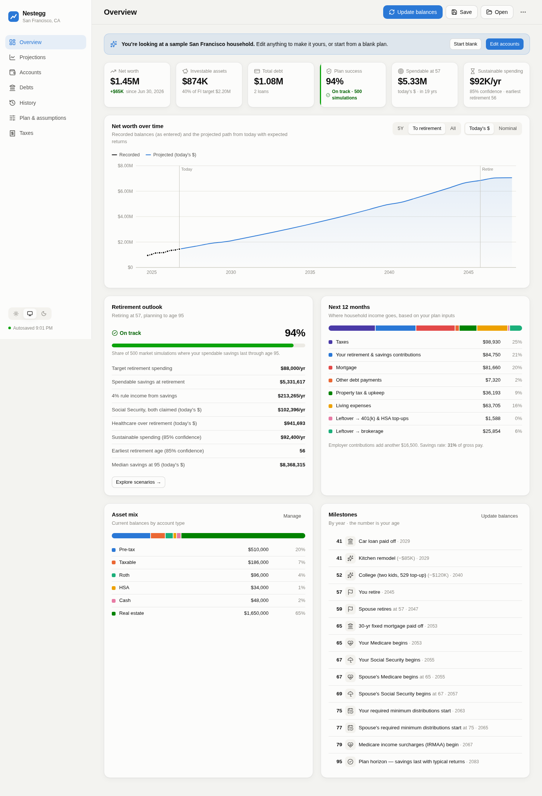
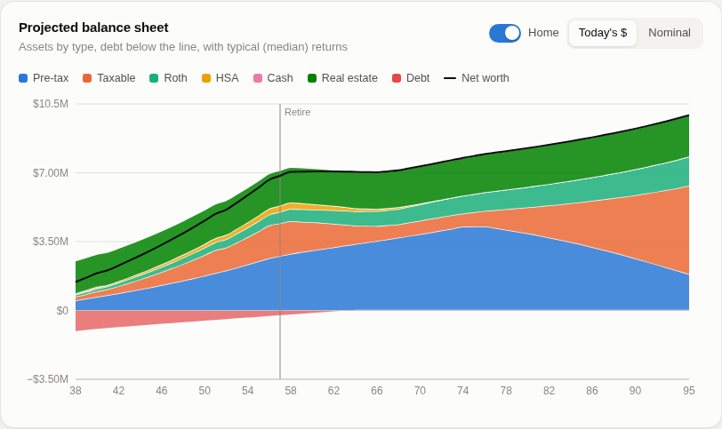
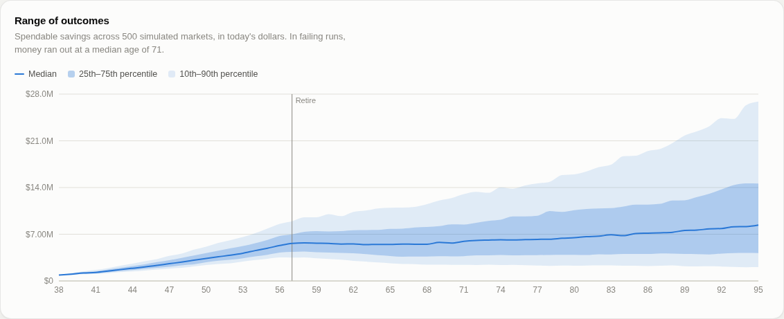
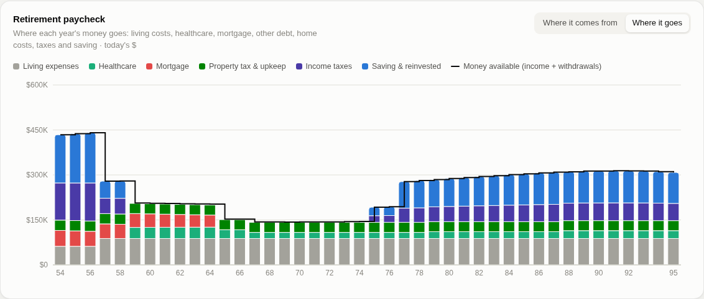
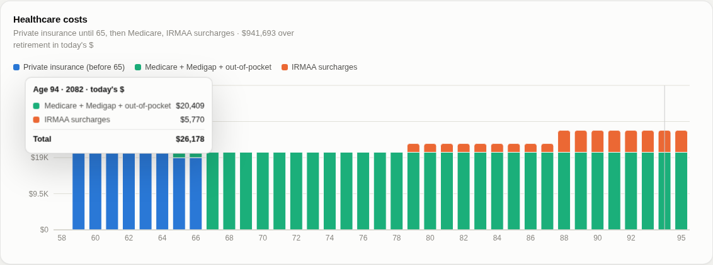
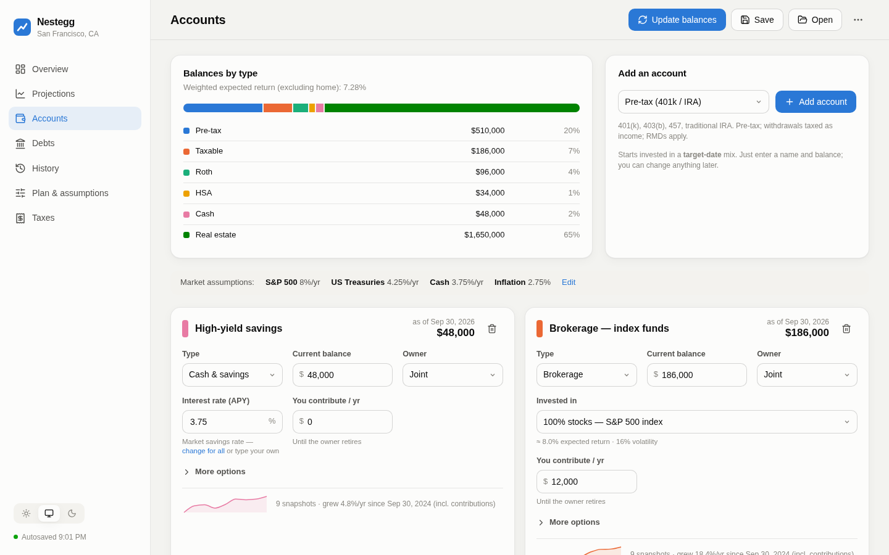
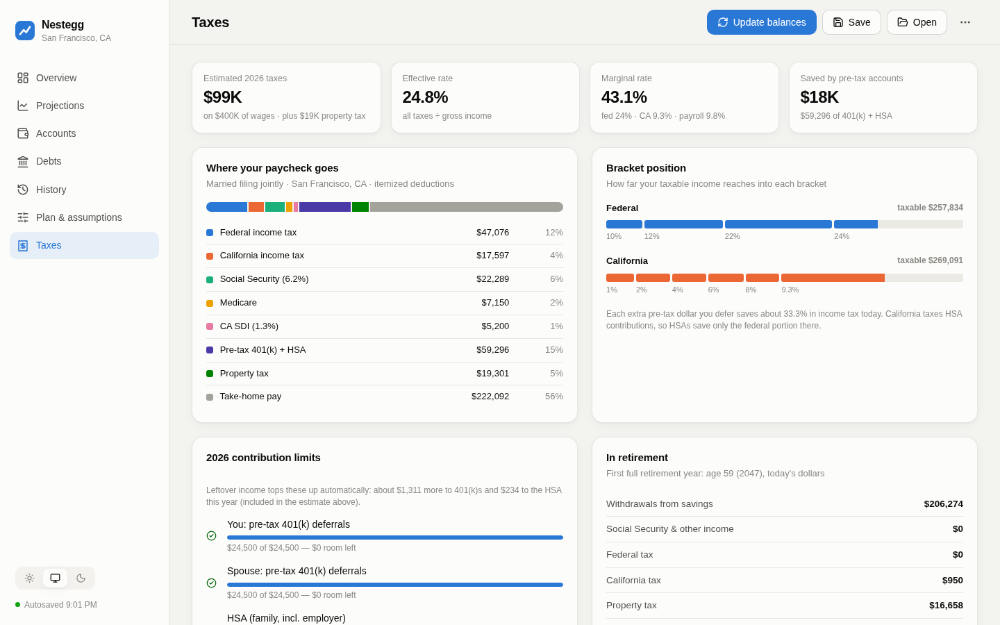
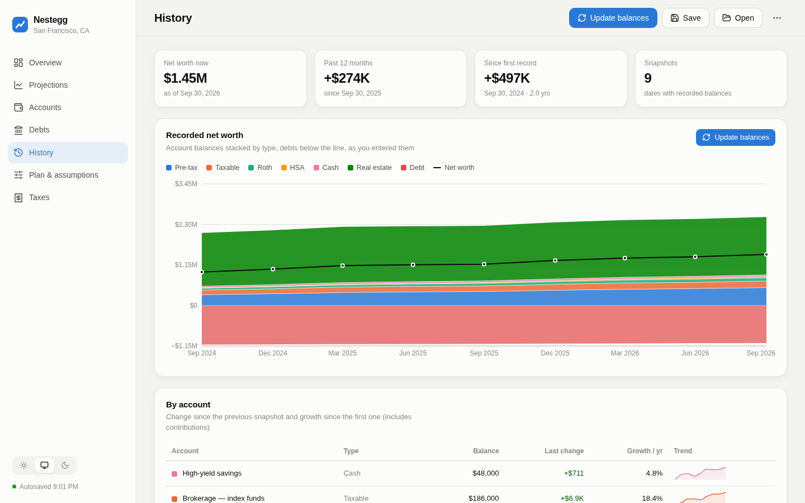
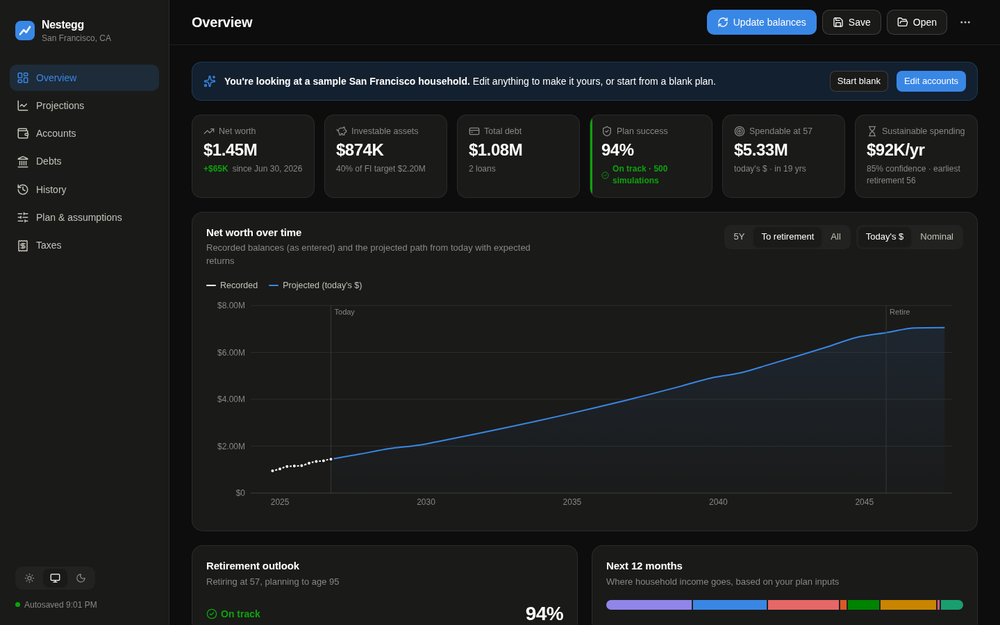
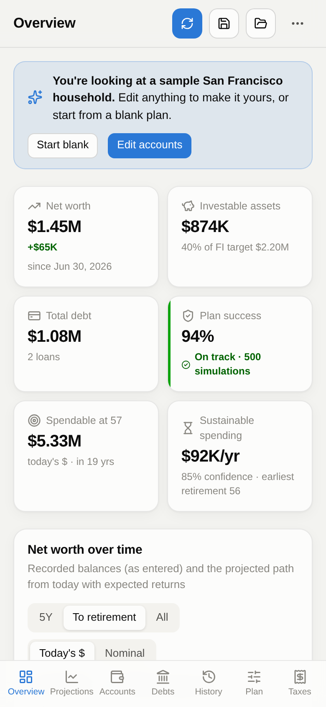

# Nestegg — financial & retirement planner

A local, private web app for tracking accounts and debts over time and projecting net worth and retirement readiness. Taxes are modeled for a married couple filing jointly in San Francisco, CA.

## Screenshots

All screenshots show the built-in sample household (a married couple in San Francisco), in today's dollars.

### Overview

Net worth, investable assets, plan success, and sustainable spending at a glance, with a net worth chart that joins your recorded history to the projection, a breakdown of where the next 12 months of income goes, and a milestone timeline.



### Projections

The projected balance sheet stacks assets by type with debt below the line, and the range-of-outcomes chart shows the spread across hundreds of simulated markets. Drag the "What if…" sliders to see them update live.





The retirement paycheck chart switches between where each year's money comes from and where it goes: living expenses, healthcare, the mortgage as its own line, home costs, income taxes and saving.



Healthcare is modeled per person: employer coverage, private insurance before 65, Medicare, and income surcharges (IRMAA).



### Accounts, taxes and history

Each account only needs a type and a balance. Pick what it's invested in and returns come from shared market assumptions.



Federal, California, payroll and property taxes, bracket positions, and 2026 contribution limits.



Record dated balance snapshots to build up history, then see it stacked by account type.



### Dark mode and phones

The layout adapts to the system theme and to narrow screens.

<p>
  
  
</p>

## Run

```bash
npm install
npm run dev        # http://localhost:5173
```

`npm run build && npm run preview` serves the production build.

## Your data

- **Autosave**: every change is saved in this browser (localStorage).
- **Save / Open**: writes and reads a `.json` plan file. In Chrome/Edge, Save keeps writing to the same file after the first time. Keep this file as your backup; it's the only copy outside this browser.
- **Update balances**: records a dated snapshot of every account and debt. That's how you build history over time. You can edit or delete past snapshots on the History page.

## What's modeled

- Accounts only need a type and balance. Each investment account picks what it's **invested in**: a target-date glide path (the default for 401(k)/IRA/Roth), an S&P 500 index (the default for brokerage and HSA), a stock/bond split (bonds = US Treasuries), or a custom return. Cash earns the market savings rate. Returns for every account come from one set of **market assumptions** on the Plan page (S&P 500 8%, Treasuries 4.25%, cash 3.75% by default).
- Other inferred defaults: a standard payment for new debts based on loan type, typical rates by debt type, "max out" buttons for 401(k)/IRA/HSA limits, and Social Security computed with SSA's formula from each person's income, age and retirement age (top 35 years, 2026 bend points, spousal benefit), overridable with your ssa.gov figure.
- Pay left over after taxes, spending, debt payments and your contributions is invested every working year. It fills each spouse's 401(k) to the IRS limit (with catch-ups) first, then the HSA to its limit, then brokerage. Taxes are recalculated because the first two are pre-tax. If you don't have one of those accounts, the projection adds a $0 placeholder you can add with one click. The share invested (default 100%) and each step can be changed on the Plan page.
- Healthcare is modeled per person. While either of you has a paycheck, the whole family (including a retired spouse and anyone past 65) stays on that employer plan, and Medicare starts when that coverage ends. After that it's private insurance until 65, then Medicare (Part B/D, Medigap, out-of-pocket), plus IRMAA surcharges based on income two years earlier. There's an optional long-term care stress test. Costs rise at inflation plus a premium (default +2 points) that fades to zero over 30 years. Once you pay for your own healthcare, the HSA pays those bills first (tax-free); other HSA withdrawals are tax-free only up to the medical costs incurred.
- California property tax on each home under Prop 13: the assessed value from your tax bill grows at most 2% a year (never above market value), at SF's ~1.18% rate, plus parcel taxes and the homeowner's exemption. It's deducted when itemizing beats the standard deduction: federal SALT cap (~$40K in 2026, phasing down at high income, $10K from 2030) plus mortgage interest on up to $750K; California has no cap on property tax and allows interest on up to $1M.
- Debts amortize monthly using their rate, payment and any extra principal.
- Each year: wages, Social Security (with claiming-age adjustment), pensions and one-time events come in. Federal tax (2026 brackets), California tax, FICA and CA SDI go out, along with spending, debt payments and contributions.
- Retirement withdrawals go cash → taxable → pre-tax → Roth → HSA, grossed up for the taxes they cause. Homes also cost upkeep (default 1% of value a year) on top of Prop 13 property tax. The deterministic projection (balance sheet, timeline, milestones) uses median returns (expected return minus volatility drag) so it matches the middle of the Monte Carlo range. It also models the 10% early-withdrawal penalty, RMDs, taxation of Social Security, and California's treatment of HSA contributions and capital gains.
- Monte Carlo runs lognormal returns to estimate the probability of success. Each account loads on shared yearly stock and bond shocks by its mix (stocks–Treasuries correlation 0.1, homes 0.3 with stocks), so same-fund accounts move together. It also finds your sustainable spending and earliest retirement age at your chosen confidence level. These run in a web worker.

This is a planning tool, not tax or investment advice. It doesn't model AMT, NIIT, itemized deductions beyond property tax and mortgage interest, Roth conversions, spousal/survivor Social Security benefits or dividend tax drag.

## Tests

```bash
npm test                                   # engine unit tests (taxes, amortization, projection, Monte Carlo)
npm run dev -- --port 5317 &               # then, with the dev server running:
node scripts/e2e.mjs                       # end-to-end: update balances, save/open file, persistence, edits
node scripts/shots.mjs shots               # screenshots of every page, light/dark, desktop/phone
node scripts/readme-shots.mjs             # regenerates the README screenshots in docs/screenshots
```

The browser scripts use `playwright-core` with `/usr/bin/chromium` (override with `CHROME=/path`).
